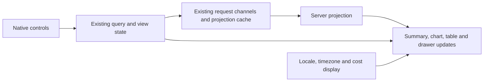

# Desktop dashboard UI refactor plan

Status: local implementation and integration review complete; final user review is pending. The user confirmed the decision summary and selected uPlot after the native/uPlot comparison on 2026-09-30. Platform verification limits are recorded in the deep audit.

Implementation progress on 2026-09-30: Phase 0 baseline is committed as `2979899`; Phase 1 repairs as `a38a3c1`; Phase 2 shared CSS and controls as `2d1bcf3`; the Phase 3 comparison checkpoint as `2a4773d`; production uPlot integration as `bbeaa8e`; Phase 4 composition, quota, bounded Session scrolling, pricing rows, overview precision, retained-query recovery, and settings dirty state as `6b10d5d`. The user selected full Phase 5 in a dialog after the Phase 4 commit. Integration review repaired unavailable-provider projections, export availability and filename extensions, and budget lower-bound labels. The final client checks and direct desktop flows passed within the documented environment. Historical comparison measurements remain in `docs/chart-engine-comparison.md`.

## Outcome and confirmed scope

Make the whole desktop interface reliable and consistent: dashboard, charts, session explorer, detail drawer, and shared settings controls. The user confirmed this scope and requested a comparison of native rendering and chart libraries.

Keep the confirmed overview-first direction. Retain the documented dark neutrals, teal action color, system fonts, Traditional Chinese and English, native controls where practical, and desktop-only support from 960px upward. This is a production-quality refactor proposal, not a static mockup.

The primary task is to inspect usage for a chosen provider and period, understand coverage and source quality, and locate the sessions behind the totals. Account-plan quota is separate from local JSONL estimates and must stay visibly distinct.

The working tree includes the previous overview refactor. Before a new development phase begins, inspect and commit the completed current phase as required by `AGENTS.md`. This planning pass does not make that commit.

## Design decisions

### User decisions recorded on 2026-09-30

| Topic | Confirmed decision | Pending detail |
| --- | --- | --- |
| Scope | Whole desktop interface, including session details and settings. | None. |
| Chart engine | Compare native/uPlot at the same position, then use the user-selected uPlot engine with pinned local assets. | None. |
| Information priority | Keep a compact quota strip below the KPIs. Show remaining quota, reset time, and update status; disclose full quota details. Follow with usage analysis and Session. | None. |
| Advanced facets | Searchable lists with native checkboxes; persistent selected values with individual removal. Edit a draft and use Apply to update the query. Mark unapplied changes. Removing an applied chip or clearing all filters takes effect immediately and reconciles corresponding draft values. | None. |
| Chart interactions | Include time zoom and reset in both prototypes. Snap interval selection to complete data buckets, show boundaries and timezone, and apply it through an explicit button. Provide a return to the prior query. | None. |
| Session scrolling | Use a bounded table region with its own vertical scroll, sticky headers, and retained pagination. | None. |
| Session details | Keep a modal drawer with a stable shell, inactive background, and correct focus restoration. | None. |
| Trend presentation | Provide all three modes: a single selected metric, two vertically stacked charts, and a dual-axis chart. Default to a single cost metric. Use a direct chart-toolbar switch and remember the mode locally; mode changes do not request data. Compare both engines against these modes. | None. |
| Default density | Use Comfortable for users without a stored preference. Preserve existing saved density preferences. | None. |
| Trend marks | Provide both bars and unsmoothed lines through a direct switch. Default to bars to match interval totals and complete-bucket selection; the user delegated this default to UX judgment. Remember the choice locally and preserve selection and zoom on change. Include both in the comparison prototype. | None. |
| Selected values | Show a compact hover tooltip and a stable complete value region outside the plot. Stop pointer preview on leave; clicking pins a selection, and keyboard selection remains available. | None. |
| Session entry | Use one named detail button per row. Allow text selection; the row itself is not an additional activation target or tab stop. | None. |
| Cost precision | Use short overview costs and precise detail costs. Complete overview costs use two decimals; a positive amount below USD 0.01 is shown as below that threshold. Readout, data table, and details use up to six decimals. Keep partial-cost lower-bound semantics explicit. | None. |
| Settings groups | Keep the four current groups visible and expanded, with field help, errors, a clear Save action, and unsaved-change status. Retain explicit saving and restart requirements. In-app navigation offers keep editing or discard; browser exit/reload uses its native unsaved-change prompt. | None. |
| Quota details | Expand complete quota cards in place beneath the compact strip. Retain source and update-state information. | None. |
| Failed query | Retain the last successful data with its original period and filters visibly labeled. Offer retry or return to the original query. Disable interval application and current-query export while retained data does not match the requested query. | None. |

The user confirmed the complete decision summary and explicitly finished the initial interview. The baseline phase was committed before implementation. After reviewing the comparison checkpoint, the user selected uPlot as the production engine. Further phase decisions use a dialog, as requested by the user.

1. Preserve the current visual language; improve consistency, density, and behavior.
2. Repair data labels, hidden states, timezone display, and modal focus before changing chart engines.
3. Establish CSS component boundaries before moving panels or adding controls.
4. Keep the current APIs, server aggregation, cost coverage, snapshot behavior, URL keys, local-storage keys, and provider isolation.
5. Use progressive disclosures, semantic tables, native form controls, and a small set of button variants.
6. Add no framework, global state library, CSS utility framework, remote font, CDN, or tracking.
7. Compare native rendering and uPlot through a bounded prototype with local, pinned assets after development starts. Add a production chart dependency only after the comparison and an explicit engine decision.

The existing design documentation supplies the theme and product context. No new palette exploration is required. Reference criteria are this project's native table and form behavior, the WAI modal pattern, and documented chart time-scale behavior. External product screenshots are not required to establish the direction.

## Findings that control sequencing

The deep audit records 20 findings, including eight P1 defects. Fix these before the final visual pass:

- F01: Author CSS overrides hidden state.
- F02: Drawer replacement loses focus and Tab escapes into the background.
- F03: The view panel starts at x=-98 at 960px.
- F04: Unequal dates are plotted at equal distances.
- F05: Partial-cost markers differ between tooltip and data table.
- F06: Supporting text contrast falls below 4.5:1.
- F07: Session density changes the trend table and causes overlap.
- F14: Session dates do not use the selected timezone.

Detailed evidence, source locations, and review limits are in `docs/dashboard-deep-audit.md`.

## Target layout

| Region | Information and actions | Desktop rule |
| --- | --- | --- |
| Header | Product identity, provider, view options, settings, explicit JSONL refresh | Compact identity; primary refresh; wrap tools safely. Keep update and pricing actions available but secondary. |
| Query context | Period, actual start/end, timezone, active filters, search scope | Show the current query and distinguish it from any retained prior projection. Advanced facets stay collapsed by default. |
| Summary | Four usage KPIs, token breakdown, cost coverage, quality notice | Four columns on wide desktops, two below 1200px. Avoid broken numeric strings. |
| Compact account quota | Remaining quota, reset time, update status, expandable full details | Keep visible below KPIs. Quota retains the account service's own periods and does not change with the local usage range. |
| Local usage insights | Trend and model ranking | 3:2 columns at wide sizes; stack at smaller supported sizes; align tops. Expanded tables must not stretch or overlap unrelated panels. |
| Session explorer | Search, sort, local density/columns, semantic table, paging | Bounded vertical scroll with sticky headers; table horizontal overflow; stable focus and selection. |
| Supporting usage | Comparison and local budgets | Keep below the explorer; maintain a clear separation between token estimates and account-service quota. Reduce empty-panel height. |
| Maintenance disclosures | Export, price details, watcher state, diagnostics | Keep explicit actions and recovery in context. Use label/value pricing rows. |
| Settings | Local configuration groups, validation, Save, restart requirement | Share controls and actions with dashboard; preserve all server restrictions. |

The user approved compact quota visibility while keeping the main analysis space available. All existing functions remain reachable.

## CSS structure

Use the existing CSS pipeline. No bundler is needed. Suggested responsibility boundaries:

| File | Responsibility |
| --- | --- |
| `public/styles/tokens.css` | Palette roles, readable secondary text, control sizes, spacing, type, focus, chart lines, layer order. |
| `public/styles/base.css` | Box model, document defaults, semantic hidden behavior, reduced motion, base form typography. |
| `public/styles/components.css` | Shared buttons, labeled controls, status notices, disclosures, panels, dialog shell. |
| `public/styles/dashboard.css` (new) | Header, period context, summary, supporting panels, desktop breakpoints. |
| `public/styles/data-views.css` (new) | Trend, selected-value display, model ranks, session table, pricing table. Every density rule is scoped to its owner. |
| `public/styles/settings.css` (new) | Settings form and its layout only. |

Split by ownership, not by every small widget. Load only needed page styles from each HTML entry. Existing static serving accepts `.css` and `.mjs`; preserve its path checks and CSP when adding files.

First remove global density selectors from generic `table`, `th`, and `td`. Add component-owned classes, then move rules without changing their values. Introduce semantic states next. Remove old late overrides only after equivalent behavior is verified.

Avoid a permanent old/new CSS override stack. Use normal classes with predictable specificity. Add `@layer` only if target-browser evidence makes it useful; it is not required for this plan.

## Shared interaction contract

| Primitive | Required behavior |
| --- | --- |
| Button | Primary, secondary, quiet, and remove variants; 40px ordinary controls and 32px compact actions; enabled hover/pressed; distinct focus; unavailable and busy states; readable operation labels without width jumps. |
| Focus | One named focus style for buttons, links, inputs, selects, summaries, chart keyboard region, and any retained row action. No reliance on color alone. |
| Select | Native provider, period, unit, density, and sort controls. Consistent heights and labels; no placeholder used as the sole label. Keep OS popup behavior. |
| Multi-select facets | Preserve current URL values and keys. Use searchable native checkbox lists for models and workspaces, native checkbox groups for small fixed categories, and persistent active-value remove buttons. Separate draft selections from applied query state, mark unapplied changes, and update on Apply. Do not build a custom combobox during the first migration. |
| Disclosure | Enter/Space toggle through native semantics; visible open state; Escape closes the view panel and returns focus. No modal focus trap for ordinary disclosures. |
| Date and timezone field | Explicit labels and selected timezone. Validate custom start/end order. Associate errors with the relevant fields using `aria-describedby` and `aria-invalid`. Preserve server validation. |
| Notice | Info, warning, error, and success states. Place a failed operation's cause and recovery near that action. Reserve layout only where it prevents a material shift. |
| Drawer | Stable shell, contained Tab sequence, inactive background, stable focus across loading/detail/error, Escape close, connected-trigger focus return and a defined fallback. |
| Data table | Semantic headers, numeric alignment, component-owned density, clear overflow, one named detail button per row. No additional row activation or tab stop. Allow text selection. No ARIA grid unless new spreadsheet behavior is requested. |
| Quota display | Keep remaining and used labels explicit. Accessible value text names which percentage is represented. Preserve unavailable service responses. |
| Loading | Distinguish first load, refresh, query change, and service quota load. On a failed new query, retain and label the previous data with its original period and filters, provide retry/return, and disable interval application and current-query export. Never present prior metrics as the active query without a clear retained-snapshot label. |

The size rules are desktop design targets, not a claim that every desktop action needs a 44px touch area. Disabled controls must not receive the same hover/pressed treatment as enabled controls. Respect reduced motion and avoid decorative animation.

## Plot and chart contract

The term plot describes the data coordinates; chart includes axes, selection, summary, table, and state. Both need one explicit contract.

- The server owns aggregation, bucket boundaries, token totals, cost coverage, and timezone membership.
- Plot X coordinates use timestamps. Calendar buckets may have different durations; retain supplied interval boundaries, including DST.
- Missing buckets are not automatically zero. Display gaps or absence unless the source contract defines a zero observation.
- Provide a bar/line switch, default to bars, and remember the choice locally. Bars represent the supplied bucket intervals; unsmoothed lines use real time coordinates and do not bridge known missing intervals as observed usage. Preserve the same values, units, coverage labels, selected interval, and semantic table across mark changes. The comparison covers both mark types for each presentation mode.
- Use a linear, nonnegative Y scale with a zero baseline. Add readable numeric ticks and units. Do not use spline smoothing that implies unobserved behavior.
- Offer single-metric, vertically stacked Token/cost, and dual-axis modes. Default to a single cost metric unless a stored preference exists. Provide the mode control in the chart toolbar and persist it locally using a backward-compatible preference extension. Stacked charts share the time domain and interval selection. Dual-axis mode labels both units and each series explicitly; never imply that the independent scales establish a correlation. Mode switching must preserve time selection and zoom without requesting data. Include all modes in the engine comparison.
- Show interval start/end and timezone in selected details. Keep point labels compact and localized.
- Share partial-cost formatting across tooltip, summary, data table, model ranks, and drawer. Unknown cost differs from a known zero.
- Use context-aware cost precision: short overview values and up to six decimals in detailed readouts and tables. A below-threshold label for a complete cost is not an upper bound on an incomplete cost. Partial costs retain a known-subtotal/lower-bound label and sufficient precision rather than combining contradictory lower-bound and below-threshold symbols. Test small positive values as well as zero and unknown.
- Show a compact pointer tooltip and a complete stable selected-value region outside the drawing area. Idle display must not cover the plot with a persistent large tooltip. Stop pointer preview on leave; clicking pins a selection. Pointer preview, pinned selection, and keyboard selection must be distinct. Restore pinned values after preview ends; do not announce every mouse movement through a live region.
- Left/Right/Home/End continue to work. Escape dismisses preview without interfering with a higher-priority open drawer. Pointer selection must use time coordinates rather than index spacing.
- Retain selection by timestamp when the metric or view preference changes. Select a documented fallback only when the point no longer exists.
- Include zoom and reset in the comparison prototypes. Zoom alone changes only the visible chart domain. Snap interval selection to complete data buckets and display start/end plus timezone. An explicit Apply interval action updates the local usage query and its KPI, model, and Session projections; account quota retains its service-defined period. Provide a return to the prior query. Keep the server's half-open interval semantics.
- Compare previous and next selected points before doing work. Schedule at most one paint per animation frame, cache geometry until data or dimensions change, and clean up observers/listeners.
- Resolve font and color tokens once per style/size change. Do not pass unresolved CSS variable strings as a Canvas font.
- Data tables use the same values and coverage qualifiers as the chart. Model bars must represent real ratios, with no unexplained minimum visual width that exaggerates small amounts.
- Model ranking can show the current top eight, but it must disclose omitted items and give access to a complete semantic list when needed. Do not add a synthetic Other cost total that hides unknown coverage.

### Engine comparison

| Option | Useful fit | Additional project work | Position |
| --- | --- | --- | --- |
| Refactored native Canvas plus HTML/SVG labels | Current sparse aggregated trend and simple model ranking | Implement honest time geometry, axes, lifecycle, tooltip, keyboard behavior, and table parity. Keeps zero frontend dependencies. | Baseline candidate in the approved comparison prototype. |
| uPlot | Focused time-series interactions, time scales, shared cursor, or future zoom | Map timestamps to its columnar format; provide project keyboard selection, selected-value text, semantic table, locale, timezone, and partial-cost handling. Review label collision behavior. | Selected by the user after the comparison; integrated as the sole production engine. |
| Chart.js | Standard line/bar charts and a familiar plugin ecosystem | Its time scale needs a date library and adapter. Canvas accessibility and project keyboard/table behavior still need application work. | Viable, but brings more date integration than this scope currently needs. |
| Apache ECharts | Several chart types, broader analytics interactions, choice of Canvas/SVG | Configure renderer and import/register required components. Enable and validate ARIA descriptions; still provide project keyboard/table behavior and accounting labels. | Consider only if a broader chart scope is approved. |

These are fit judgments from the current code and official documentation, not measured package-performance results. No dependency was installed, no CDN was added, and no current bundle sizes were compared.

Primary sources checked for this plan:

- [uPlot documentation](https://github.com/leeoniya/uPlot/blob/master/docs/README.md): columnar numeric timestamps, null values, and scales.
- [uPlot project](https://github.com/leeoniya/uPlot): time scales, cursor synchronization, zoom, and documented limits.
- [Chart.js time scale](https://www.chartjs.org/docs/latest/axes/cartesian/time.html): time-proportional placement and required date adapter.
- [Chart.js accessibility](https://www.chartjs.org/docs/latest/general/accessibility.html): application responsibility for Canvas alternatives.
- [ECharts renderers](https://echarts.apache.org/handbook/en/best-practices/canvas-vs-svg/): selectable Canvas/SVG rendering.
- [ECharts accessibility](https://echarts.apache.org/handbook/en/best-practices/aria/): explicit ARIA component/configuration and chart descriptions.

If a library is selected, pin the version, retain its license, serve all runtime assets locally, inspect existing CSP compatibility, and test the selected build in this application. A library must pass the same behavioral contract as native rendering. Do not hide data differences behind its defaults.

## JavaScript responsibilities

Keep `state.mjs`, `request-channels.mjs`, `projection-cache.mjs`, and `projection-state.mjs` as the existing boundaries. This plan does not propose a new state framework or a concurrency redesign.

- Make `dashboard.mjs` the bootstrap and coordination entry. Expand dense one-line functions as they are changed; do not perform unrelated repository formatting.
- Extract the existing summary, metadata, quality, pricing, budget, and quota rendering into cohesive view modules only where an independent update contract exists. One module per small label is unnecessary.
- Separate query validation from view preferences. Query changes request projections; local appearance changes update only affected regions.
- Keep the drawer controller as the lifecycle owner. Update content without replacing its focused shell.
- Keep `trend.mjs` as the chart owner. A small pure geometry module can hold time coordinates, numeric ticks, and nearest-point logic if that makes focused checks independent of the DOM.
- Extend `format.mjs` with explicit locale/timezone parameters and shared coverage-aware cost display. Do not change arithmetic, round inputs before aggregation, or recompute server coverage.
- Update `explorer.mjs` without rebuilding unchanged rows for unrelated preference changes. Do not add virtualization before measurements show that 100/150/200-row pages need it.
- Keep browser-local preference migrations backward compatible. Preserve existing URL keys and documented query semantics.

Dependency flow should remain simple:

## Migration phases and commit gates

### Phase 0. Freeze the baseline

- Inspect the previous overview diff and all untracked documentation. Confirm intended files before staging.
- Commit the completed current phase before any new development phase. Keep unrelated user changes out.
- Record the current API, URL, preference, and static-serving contracts. Keep the source of truth in the existing specs.
- Use the confirmed decision record above as the implementation brief, including panel order and chart prototype scope.

Exit: The baseline commit succeeds and the working tree's remaining changes are understood. Planning documents alone do not authorize new libraries.

### Phase 1. Correctness and accessibility repairs

Files: `base.css`, `components.css`, `dashboard.mjs`, `format.mjs`, `trend.mjs`, `drawer-controller.mjs`, `drawer.mjs`, and the relevant HTML labels.

- Repair hidden-state priority, panel collision, drawer focus, partial-cost labels, timezone formatting, and readable secondary text.
- Scope session density to its table. Add explicit custom-range errors and correct KPI measure labels.
- Preserve the current layout except where it prevents the repair.

Exit: Reproduce and clear F01-F07 and F14. Run focused client checks and direct desktop checks for these defects. Stage only completed phase files and commit successfully before Phase 2.

### Phase 2. Shared CSS and control system

Files: tokens/base/shared component styles, the proposed dashboard/data-view/settings styles, both HTML entries, and component-specific event handling.

- Move styles by ownership without changing data contracts.
- Introduce named action variants, control sizes, status states, focus treatment, and disclosure positioning.
- Resolve preference scope and active-filter removal. Keep native single selects and the existing facet query keys.

Exit: Dashboard and settings share the same action/control states. Session density no longer changes other tables. Verify keyboard, hidden, disabled, busy, focus, and desktop panel bounds. Commit before Phase 3.

### Phase 3. Plot and chart rebuild

Files: `trend.mjs`, `model-breakdown.mjs`, chart geometry if extracted, formatting helpers, and data-view styles. If an engine changes, include only its approved dependency and local asset path.

- Implement timestamp geometry, ticks, selected-value details, interval labels, and table parity.
- Preserve selection and disclosures across local view changes.
- Reduce pointer redraw work and keep lifecycle cleanup explicit.
- First compare native rendering and uPlot on the same inputs and approved interactions. Record visual correctness, keyboard behavior, timezone and cost parity, measured redraw behavior, local asset size, and maintenance work. Do not send local usage data to external services.
- Present the prototype evidence for the user's production-engine decision. Implement that engine after selection; keep no simultaneous permanent native/library implementations.

Exit: Empty, one-point, zero, sparse, partial-cost, dense, large-value, timezone/DST, keyboard, and resize cases satisfy the chart contract. Measure the actual implementation before making speed claims. Commit before Phase 4.

### Phase 4. Dashboard composition and supporting views

Files: dashboard/settings HTML and page styles, summary/pricing/quota/budget views, explorer and drawer content.

- Apply the approved panel order and calmer grouping.
- Render actual selected dates and filter values in the query context.
- Replace pricing prose blocks with label/value presentation.
- Differentiate first load, no sessions, no matches, unavailable provider, stale query, failed refresh, and unavailable quota.
- Add settings dirty-state tracking, a keep-editing/discard choice for in-app navigation, and a native browser unload warning while unsaved changes exist. Clear dirty state only after a successful save; failed saves preserve edits. Do not add persistent configuration drafts.
- Preserve unknown diagnostics as unknown and make long names, IDs, exact totals, and labels readable.

Exit: Real desktop workflows pass at the supported widths in both languages. Settings Save remains same-origin and allow-listed. No mobile/tablet work. Commit before Phase 5.

### Phase 5. Integration, documentation, and delivery

- Verify a direct browser path through provider, range, filter, search, session detail, chart selection, pricing, export, and settings navigation.
- Run `npm run test:client`. Run targeted server/contract checks for static routing or a changed formatting/API contract; broaden only for demonstrated shared risk.
- Update `DESIGN.md` and this audit with final behavior and evidence. Update README only where a user workflow changed.
- Retain desktop screenshots and measured limits. Report populated Claude and Windows checks honestly if the environment still cannot run them.
- Stage the completed phase, confirm the intended diff, and commit. A release or remote push is a separate requested action.

Exit: No unresolved P1 issue in the approved scope; any retained P2 debt has an explicit owner and limitation.

## Focused acceptance scenarios

| Scenario | Completion evidence |
| --- | --- |
| Hidden state | Local settings has no remote warning; unavailable form is visually hidden; unneeded pagination is hidden. Check computed display and accessibility exposure. |
| Modal lifecycle | Loading-to-ready keeps focus inside. Tab/Shift+Tab loop inside. Escape restores focus to the trigger. Background is inactive. |
| View panel | Open with keyboard at 960px, 1200px, 1440px, and 1600px. All panel bounds lie within the viewport. |
| Density isolation | Comfortable, Compact, and Dense change only session-table layout/page capacity. Trend data table remains within its region. |
| Temporal geometry | Unequal timestamp differences produce unequal X distances. Tooltip selection matches those positions. Missing intervals are not silently zero. |
| Cost consistency | A partial point has the same lower-bound qualifier in tooltip, table, peak text, and related ranking. Unknown differs from zero. |
| Locale and timezone | Locale changes labels and number format. Selected timezone changes usage dates consistently in context, chart, session row, and drawer. |
| Error recovery | Reversed custom range names the problem near the fields. Failed query distinguishes retained data from current intent and offers recovery. |
| Chart lifecycle | Home-selected point and open data table survive an unrelated exact-value change. One active observer/listener set remains after rerender and cleanup. |
| Control states | Primary/secondary/quiet/remove actions have enabled hover/pressed, focus, disabled, and busy states. Native select labels stay readable. |
| Data scale | Long model/workspace labels, exact totals, large currency, 0/1/many points, and 100/150/200 session rows remain usable. Fixtures must be identified as tests, never shipped as real usage. |
| Desktop layout | No unintended overlap, clipped controls, or document overflow at supported widths. Horizontal overflow is owned by data tables. Check text zoom separately. |
| Settings boundary | No arbitrary keys, origins, secrets, or remote edits are enabled. Keep server-side validation and atomic save behavior. |
| Facet drafts | Checkbox edits change only the draft until Apply. Mark unapplied changes; applied query labels and URL still describe the displayed data. Chip removal and Clear update immediately and reconcile draft values without silently applying unrelated edits. Preserve existing facet keys and values. |
| Chart modes and marks | Single cost/Token, stacked Token/cost, and dual-axis modes support bars and unsmoothed lines. Defaults are single cost plus bars. A mode or mark change retains selection and zoom and does not request new projections. Missing intervals and partial costs remain explicit in every mode. |
| Zoom and interval application | Zoom changes only the plot domain. Interval selection snaps to complete buckets, displays timezone and half-open boundaries, and requires an explicit Apply action. Application updates the local usage query, URL, KPI, model ranks, and Session; returning restores the prior query. Account quota stays in its own service period. |
| Tooltip and readout | Pointer preview uses a compact tooltip and complete external readout. Leave ends preview; a pinned selection remains. Keyboard selection works in every presentation mode; live announcements do not follow every mouse movement. |
| Quota composition | The compact quota strip remains visible below KPIs. Full details expand in place. Show remaining amount, reset time, freshness, source, and unavailable states without claiming local usage determines service quota. |
| Cost precision | Overview costs are short; detailed costs use up to six decimals. Complete small positive costs are distinguished from zero. Partial known subtotals remain lower bounds and do not produce contradictory threshold labels. Unknown costs remain unknown. |
| Settings dirty state | Four groups remain visible. Successful Save clears dirty state and keeps the restart notice. Failed Save preserves edits. In-app departure offers keep editing or discard; browser departure warns only while dirty. No persistent draft is added. |
| Session interaction | Comfortable is the fallback for an unset preference. Table scrolling owns its sticky header and keeps paging available. Each row has one named detail button, text remains selectable, and modal close restores focus. |
| Preference compatibility | Persist chart mode and mark locally through a backward-compatible extension. Preserve existing locale, unit, density, columns, and provider preferences. Test an existing stored preference without the new fields. |

Do not run every state at every width. Check baseline layout at four desktop widths; run each behavioral defect at its trigger width and one ordinary desktop size where needed. Test new behavior after implementation, not before it as TDD.

For Windows-local follow-up, the existing project commands remain `npm run test:client`, `npm run test:contract`, and `npm start`. Use a supported desktop browser for native select, keyboard, text zoom, and forced-colors checks. The macOS review cannot stand in for those platform checks.

## Risks and open implementation decisions

- Shared CSS changes can affect settings; Phase 1 and Phase 2 must inspect both pages.
- Replacing whole regions can lose focus, selection, and native form state; update contracts must be established before splitting modules.
- Changes to time geometry and labels must preserve server accounting. This plan intentionally does not change aggregation or fill missing buckets.
- A chart library can reduce axis work but will not automatically preserve keyboard interaction, table parity, coverage semantics, or timezone meaning.
- Populated Claude, screen-reader behavior, Windows native controls, large-data frame times, and text zoom remain validation gaps.
- The user selected uPlot after reviewing both candidates. Its local asset and version maintenance are accepted; production timing is not inferred from the archived comparison benchmark.

## Planning-pass validation

Source and real browser evidence were collected during the audit. The decision interview updated this plan and its acceptance scenarios; the user confirmed the summary and ended the interview. Documentation passed `git diff --check`. No dependency install, product implementation, settings save, commit, release, or remote push occurred during this planning work. Application tests were not rerun because this pass changed documentation only. Review the deep audit for the exact tested cases and remaining gaps.
